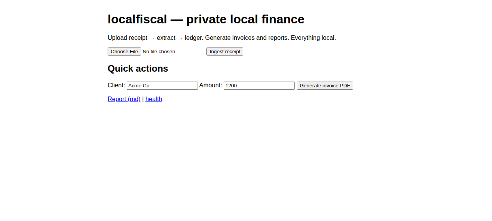

# localfiscal

**Receipts, simple invoices and a private ledger for a one-person business.**

Keep income and expenses on your own computer instead of paying for a bookkeeping suite you barely use. Your ledger is one SQLite file; receipt originals, invoice PDFs and exports are separate files. No account or subscription is required to run the MIT-licensed code.



## What it can replace

For solo users who manually record transactions, localfiscal can cover the basic receipt, invoice-PDF and ledger-export jobs they might otherwise use FreshBooks, Wave, QuickBooks Online or Stripe Invoicing for.

| Job | Included | Left out compared with a full paid service |
|---|---|---|
| Receipts | Extract PDF/text receipts; flag unreadable amounts | No bank feeds, guaranteed OCR or reconciliation. Scanned images generally need optional local vision. |
| Invoices | Basic invoice PDFs | No card collection, payment pages, reminders, recurring billing or invoice-number workflow |
| Books | Income, expenses, exact minor-unit money and per-currency totals | No double-entry accounting, payroll, tax filing or inventory |
| Accountant handoff | CSV and OFX transaction exports | No guarantee every accounting product imports every field; check a sample first |
| Access | CLI and a small local browser screen | No mobile app, cloud sync, authentication or multi-user permissions |

Reports include **all dates**: their period argument is a label, not a date filter. This is recordkeeping software, not accounting or tax advice.

## Install on macOS, Windows or Linux

First install [Python 3.11+](https://www.python.org/downloads/) and [pipx](https://pipx.pypa.io/latest/how-to/install-pipx.html). Open Terminal (macOS/Linux) or PowerShell (Windows) and paste one command:

```sh
pipx install https://github.com/OrionArchitekton/localfiscal/archive/fb87e96a7f193e870239c7f47eb7d5209f74cf84.zip
```

This pins the localfiscal source; pipx resolves dependencies from PyPI at installation time, and those versions are not locked. It installs from this repository, without relying on a similarly named PyPI package or requiring Git. If the installed command is not found, run `pipx ensurepath` and open a new terminal. See the [install/recovery guide](docs/runbooks/local-install.md) for prerequisites and Docker.

Use a local disk for demo output and books; network filesystems are not supported.

## Try it in five minutes

1. Open a terminal in a folder such as Documents.
2. Run `localfiscal demo`.
3. Open the new `demo-books` folder in Finder or File Explorer. Open `invoice.pdf`, `transactions.csv` in a spreadsheet, and `report-sample.md` in a text editor. The fictional books contain **$1,250.00 income, $54.50 expenses and $1,195.50 net**. `receipt.txt` is the sample receipt and `ledger.db` is the ledger.
4. Run `localfiscal-web`, open [127.0.0.1:8080](http://127.0.0.1:8080), and stop with Ctrl+C. This screen uses your normal ledger location; the guide explains how to select the sample instead.

The demo never touches your real ledger and refuses to overwrite an existing path. Try `localfiscal demo --out another-sample` for another copy. No API key, vision model or internet is needed after installation.

## Start your own books

Use the same working folder each time: the default ledger is `data/ledger.db` relative to that folder. Back it up along with original receipts and PDFs. Set `LOCALFISCAL_DB` to an absolute path for a fixed ledger location; see the guide for PowerShell and macOS/Linux examples.

```sh
localfiscal add 2026-10-01 "Example Client" 1250.00 --income
localfiscal add 2026-10-02 "Office supplies" 42.00 --category supplies
localfiscal ingest receipt.pdf
localfiscal invoice "Example Client" 1250.00 --out invoice.pdf
localfiscal report
localfiscal export --fmt csv --out transactions.csv
```

Unreadable amounts are flagged for manual entry. Generating an invoice does **not** record income; record the payment when it arrives. There is no transaction edit/delete command yet. Check entries and retain backups. The browser screen offers receipt upload, invoice generation and report download; manual entry and CSV export use the CLI.

## Privacy

The default code path makes no network calls and has no telemetry. Optional vision sends a receipt to an Ollama endpoint only when explicitly enabled; use an endpoint you control. The web server binds to loopback and has no authentication: keep it on your own computer. The application does not encrypt financial files or backups.

## Optional setup bundle

**$99 USD one-time**, approved for the setup bundle: guided pipx installation on one computer, supplied [category/receipt templates](templates/README.md), example invoice, backup walkthrough and one 45-minute remote support session. Availability, support terms and checkout must be finalized before sale. No ongoing bookkeeping, tax work, bank integration or unlimited support. The software remains MIT; the fee pays for setup and support.

The [Swap Meet listing draft](SWAPMEET.md) has no checkout yet.

## Development

```sh
python -m venv .venv
# Activate your environment, then:
pip install -e ".[dev]"
pytest --cov=localfiscal --cov-fail-under=85
ruff check .
mypy
```

See [CONTRIBUTING.md](CONTRIBUTING.md), [CHANGELOG.md](CHANGELOG.md), the [sample-books spec](specs/sample-books-spec.md) and the [MIT license](LICENSE).
